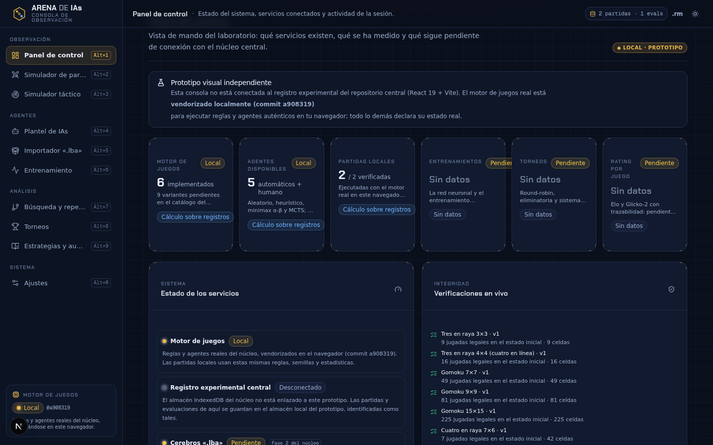
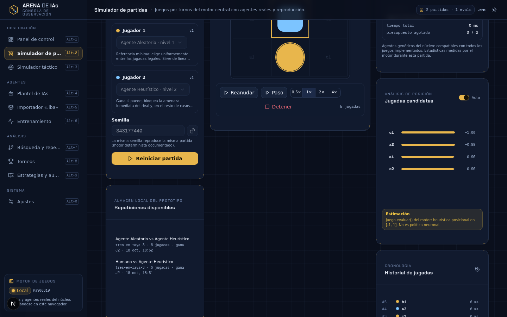
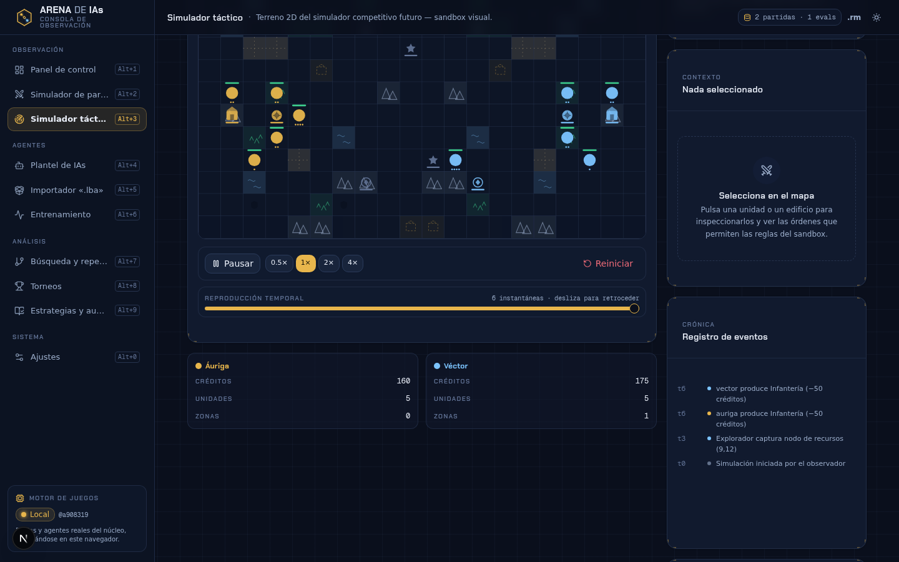
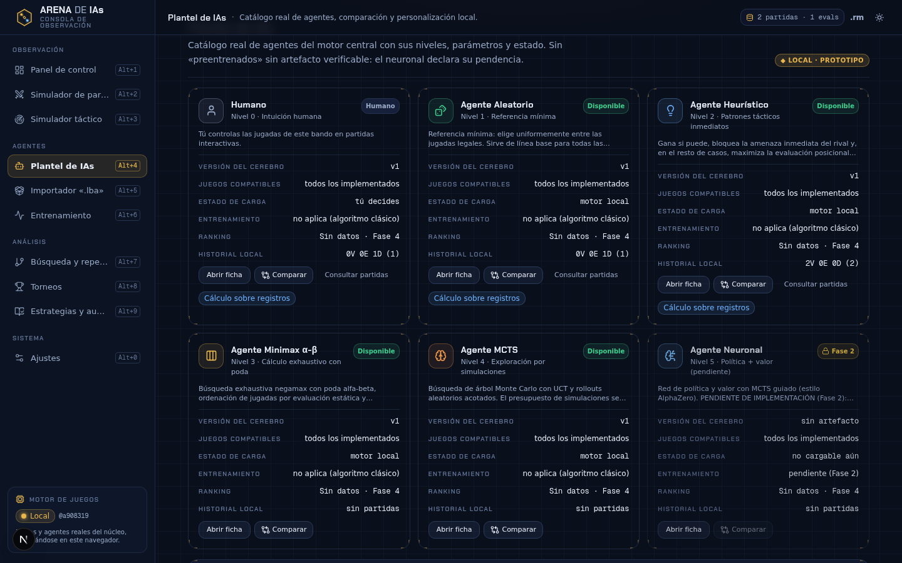
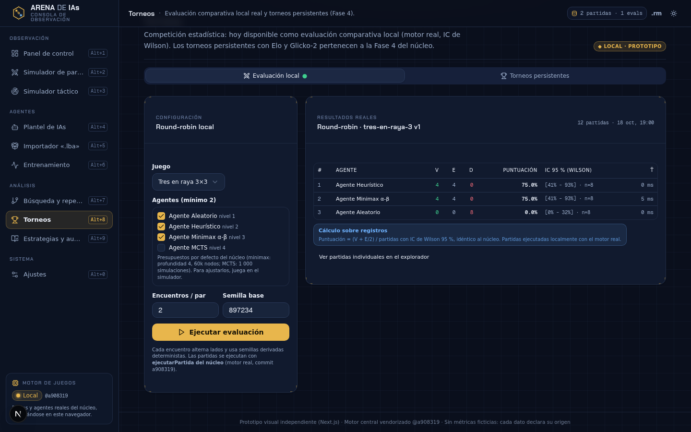
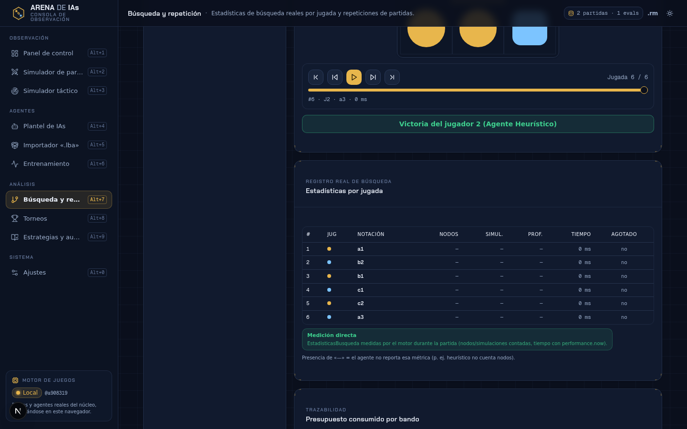
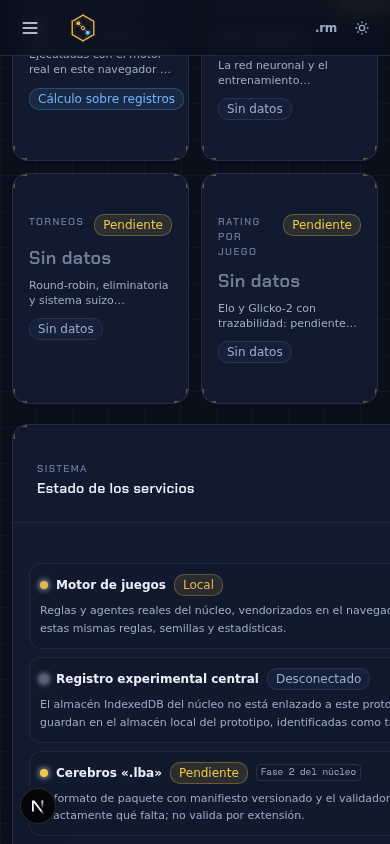
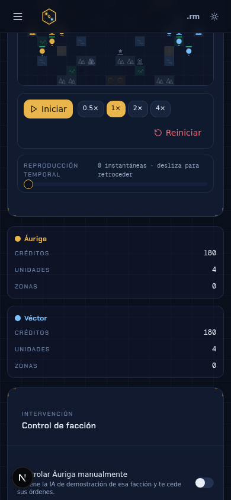
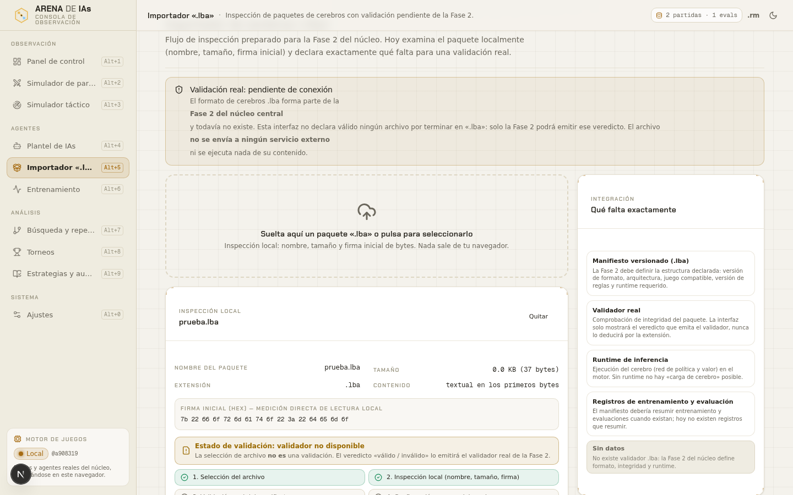

<div align="center">


# Arena de IAs

[](https://github.com/Lean031110/arena-de-ias/actions/workflows/ci.yml)

Plataforma web profesional, en español, donde agentes de inteligencia artificial juegan,
compiten, evolucionan y —en fases posteriores— aprenden por refuerzo, forman equipos y
disputan torneos con estadística honesta.

**Identidad visual del proyecto:** el hexágono-arena contiene una rejilla de juego (los tableros
de la Fase 1) y dos agentes —dorado y azul, los colores de los jugadores del motor— conectados
por trazas al núcleo central de la arena. [Fuentes del logotipo](./docs/assets/).

</div>

> **Principio rector del proyecto: integridad de los datos.**
> Ninguna cifra se muestra sin provenir de una medición real o de un cálculo reproducible
> sobre registros reales. Si un dato no existe, la interfaz lo dice («Sin datos»,
> «Pendiente», «No medido»). Consulta la política completa en
> [`PROMPT_MAESTRO.md`](./PROMPT_MAESTRO.md) (§2) y su aplicación en
> [`docs/MODELO_DATOS.md`](./docs/MODELO_DATOS.md).

## Estado actual

| Fase | Contenido | Estado |
|---|---|---|
| 0 | Arquitectura, auditoría, plan, criterios de aceptación | ✅ Completada |
| 1 | Motor de juegos, 6 variantes, 4 niveles de agentes, evaluación real, CI | ✅ Completada (la red neuronal queda para Fase 2, ver informe) |
| 2 | Persistencia completa de cerebros, entrenamiento, panel experimental | ⏳ Pendiente |
| 3 | Equipos, plantel, mentoría | ⏳ Pendiente |
| 4 | Torneos, Elo, Glicko-2, liga histórica | ⏳ Pendiente |
| 5 | Juegos restantes, descubrimiento de estrategias, garantías | ⏳ Pendiente |

Informes verificables por fase en [`docs/INFORMES/`](./docs/INFORMES/).

## Prototipo visual — «Consola de observación»

> Rama: [`frontend/prototipo-visual`](https://github.com/Lean031110/arena-de-ias/tree/frontend/prototipo-visual) ·
> [Documentación del frontend](./frontend/README.md) ·
> [Informe verificable de la entrega](./docs/frontend/INFORME-VISUAL.md) ·
> [Guía de integración en el núcleo](./docs/frontend/INTEGRACION.md)

La experiencia de observación de la plataforma está disponible como **prototipo visual
independiente** (Next.js 16 + Tailwind 4, aislado del núcleo Vite): panel de control,
simulador de partidas con los **juegos y agentes reales del motor** (dominio vendorizado
sin modificar, commit `a908319`), simulador táctico 2D con contrato propio, plantel,
importador «.lba» con validación honestamente pendiente, entrenamiento, explorador de
búsqueda, torneos con evaluación round-robin real e intervalo de Wilson, auditoría de
métricas y ajustes de accesibilidad.

| | | |
|---|---|---|
|  |  |  |
| **Panel de control** — servicios y verificaciones reales | **Simulador de partidas** — motor real, pausa/paso/velocidad | **Simulador táctico** — sandbox visual v0.1.0 |
|  |  |  |
| **Plantel de IAs** — catálogo real del núcleo | **Torneos** — round-robin local con IC de Wilson | **Búsqueda y repetición** — estadísticas por jugada |

Móvil (390 px) y tema claro «Laboratorio» verificados:

<p>



</p>

El prototipo respeta la misma regla de integridad: cada métrica declara su procedencia,
los servicios sin conectar muestran estados vacíos explicados y las estructuras sintéticas
llevan marca permanente de demostración. La incorporación al núcleo está guiada por
[`docs/frontend/INTEGRACION.md`](./docs/frontend/INTEGRACION.md).

## Requisitos

- **Node.js ≥ 22.12** (desarrollado y verificado con Node 24 y 22).
- npm ≥ 10.
- Navegador moderno (IndexedDB, Web Workers). Sin dependencias de red en ejecución:
  la aplicación funciona 100 % sin conexión.

## Instalación y ejecución

```bash
# instalar dependencias (versiones exactas fijadas en package.json + package-lock.json)
npm ci

# desarrollo con recarga en caliente
npm run dev

# comprobación de tipos (TypeScript estricto, sin emitir archivos)
npm run typecheck

# lint (ESLint 10 + typescript-eslint, configuración plana)
npm run lint

# pruebas automatizadas (Vitest, una sola pasada, sin reloj)
npm test

# build de producción (salida en dist/)
npm run build

# vista previa del build de producción
npm run preview
```

Mediciones de evaluación y solucionador (scripts con `tsx`, solo desarrollo):

```bash
npm run medir:evaluacion   # evaluación round-robin de la Fase 1 → JSON con resultados reales
npm run medir:solucionador # resolución exacta de tableros pequeños → JSON con resultados reales
```

## Estructura del proyecto

```
arena-de-ias/
├── docs/                    # documentación de arquitectura, decisiones, modelo de datos…
│   ├── assets/              # logotipo del proyecto (SVG y PNG)
│   ├── screenshots/         # capturas del prototipo visual
│   ├── frontend/            # informe de la entrega visual, guía de integración, atribuciones
│   └── INFORMES/            # informes verificables por fase
├── frontend/                # 🎨 PROTOTIPO VISUAL (rama frontend/prototipo-visual):
│   │                        #    consola de observación Next.js 16 con el motor real vendorizado
│   ├── src/motor-central/   #    dominio del núcleo copiado 1:1 (commit a908319) — no modificar
│   ├── src/lib/             #    contratos de integración + servicios + sandbox táctico
│   └── src/components/arena/#    sistema visual (10 vistas, temas, accesibilidad)
├── scripts/                 # scripts de medición real (evaluación, solucionador)
├── src/
│   ├── dominio/             # NÚCLEO: independiente de React y del navegador
│   │   ├── motor/           # contratos de juegos, RNG con semilla, partidas, eventos,
│   │   │                    # evaluación, estadística, exportación, solucionador exacto
│   │   ├── juegos/          # reglas de cada juego (tres en raya, gomoku, cuatro en raya)
│   │   └── agentes/         # niveles 1-4: aleatorio, heurístico, minimax α-β, MCTS
│   ├── aplicacion/          # servicios: persistencia IndexedDB, acceso a almacenamiento
│   ├── trabajadores/        # Web Worker de partidas/evaluaciones + cliente con reintento
│   └── interfaz/            # React: componentes, ganchos y estilos (español, accesible)
├── .github/workflows/       # CI: GitHub Actions (tipos + lint + pruebas + build)
└── PROMPT_MAESTRO.md        # especificación maestra del proyecto (token redactado)
```

Regla arquitectónica clave: **la interfaz nunca decide** legalidad, final de partida ni
resultado. Todo eso vive en `src/dominio/`, sin dependencia de React.

## Juegos implementados (Fase 1)

| Juego | Dimensiones | Victoria | Estado |
|---|---|---|---|
| Tres en raya | 3×3 | 3 en línea | ✅ Implementado |
| Tres en raya | 4×4 | 4 en línea | ✅ Implementado |
| Gomoku | 7×7 / 9×9 / 15×15 | 5 o más en línea (estilo libre) | ✅ Implementado |
| Cuatro en raya | 7 columnas × 6 filas | 4 en línea con gravedad | ✅ Implementado |

Las 9 variantes restantes (Othello 4×4/6×6, damas reducida, Hex 5×5, Breakthrough 5×5,
ajedrez reducido 5×5/6×6, y dos variantes adicionales) están catalogadas con reglas
previstas en [`docs/JUEGOS.md`](./docs/JUEGOS.md) y planificadas para la Fase 5.

## Agentes (niveles de fuerza)

| Nivel | Agente | Método |
|---|---|---|
| 1 | Aleatorio | movimientos legales equiprobables (RNG con semilla) |
| 2 | Heurístico | gana si puede, bloquea amenazas inmediatas, evaluación posicional |
| 3 | Minimax | negamax con poda alfa-beta, ordenación de jugadas y presupuesto de nodos/profundidad |
| 4 | MCTS | UCT con rollouts aleatorios acotados y presupuesto exacto de simulaciones |

El nivel 5 (red de política y valor, estilo AlphaZero) tiene contrato definido y estado
«Pendiente»: no se incluye ninguna interfaz que simule estar entrenada.

## Reproducibilidad

- Toda partida se ejecuta con un RNG propio derivado de una **semilla registrada** en el
  registro de la partida.
- Los registros guardan movimientos en notación textual; cualquier partida puede
  **reproducirse** y **validarse** moviemiento a movimiento.
- Las huellas de integridad (FNV-1a de 32 bits) cubren el núcleo determinista del registro
  y **no** son prueba criptográfica de autenticidad (limitación documentada).

## Desarrollo

- TypeScript estricto (`strict`, `noUncheckedIndexedAccess`, `noImplicitOverride`…).
- ESLint 10 con `typescript-eslint` 8 (configuración plana) y reglas de hooks de React.
- Vitest 5: pruebas unitarias y de propiedades (bucles deterministas con semilla) sobre el
  dominio completo; `fake-indexeddb` para la capa de persistencia.
- Dependencias con **versión exacta** (sin rangos) y `package-lock.json` versionado.
- CI en GitHub Actions: `npm ci` → typecheck → lint → pruebas → build.

## Licencia

MIT — véase [`LICENSE`](./LICENSE).
